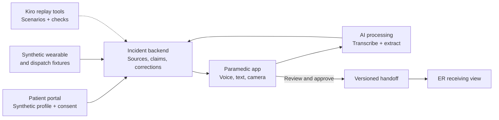

# SceneBrief — Demo Build Plan and Team Split

October 24, 2026 · Four-person hackathon team

Build one complete incident across three interfaces: **patient setup → paramedic workflow → ER handoff**. The paramedic’s voice-to-clarification loop should receive most of the engineering and design effort.

Divide ownership by component, with one shared data contract agreed upfront. See the [consolidated user journey](user-journey.md) for the detailed workflow and synthetic scenario.

## 1. Components required for the demo

| Component | What to build | Demo boundary |
| --- | --- | --- |
| Patient setup | Fictional patient profile, wearable connection states, sharing preferences, demo QR/code | Simulated enrollment and wearable connections |
| Paramedic app | Open incident, match patient, inspect timeline, dictate observations, review a discrepancy, record clarification | Mobile-first web app |
| AI processing | Speech transcription, structured claim extraction, source-linked clarification proposals, handoff drafting | Uses supplied incident evidence; no diagnosis |
| Incident backend | Stores source records, claims, corrections, measurements, review status, and handoff versions | One synthetic incident, with reset and replay |
| ER receiving view | Reviewed handoff, expandable sources, amendment indicator | Second browser window updated from the backend |
| Kiro replay tools | Load scenario, inject statements, inspect changes, check expected outcomes | Demonstrates development and verification with Kiro |

Use the shared backend as the source of truth. AI output proposes structured changes; application logic validates and records them.



## 2. Four-person ownership split

| Team member | Ownership | Concrete deliverables |
| --- | --- | --- |
| 1 — Paramedic experience | Main mobile interface and interaction design | Incident brief, timeline, push-to-talk, transcript editing, clarification card, voice/text correction, handoff review |
| 2 — AI and evidence processing | Turning input into source-linked claims | Transcription adapter, extraction schema, clarification generation, handoff drafting, evaluation fixtures |
| 3 — Backend and integrations | Shared state and incident lifecycle | Database/API, synthetic data loader, patient matching, correction history, handoff versions, live updates, replay MCP tools |
| 4 — Patient/ER experience and demo integration | Supporting interfaces and overall presentation | Patient setup, demo QR/code, ER handoff view, scenario reset controls, visual consistency, end-to-end demo rehearsal |

**Member 4 is also the integration owner.** Connect real endpoints early and keep the complete demonstration working as the other components evolve.

## 3. Shared data contract

Agree on these typed objects before working separately:

```text
SourceRecord
  id, patientId, type, eventTime, capturedAt, payload

Claim
  id, incidentId, statement, sourceIds,
  eventTime, capturedAt, status

Clarification
  id, relatedClaimIds, evidenceSourceIds,
  question, status

Correction
  id, originalClaimId, replacementClaimId,
  author, recordedAt, reason

Handoff
  id, incidentId, version, sections,
  reviewStatus, reviewedBy, reviewedAt
```

Contract rules:

- Device events and witness claims remain distinguishable.
- An unknown time stays unknown.
- Corrections preserve earlier statements.
- Reviewing a handoff does not make every underlying claim medically confirmed.
- Later changes create amendments to a shared handoff.

Member 3 owns the contract, but all four review it before building. Define timestamp handling, nullable fields, and status values together so interfaces do not interpret them differently.

## 4. How each member uses Kiro

Give Kiro shared project instructions covering the data contract, terminology, design system, and evidence boundaries. Create a separate spec for each workstream.

| Owner | Kiro spec | Acceptance criterion |
| --- | --- | --- |
| Member 1 | `paramedic-capture-and-clarification` | Recording a clarification updates the timeline without clearing unrelated uncertainties. |
| Member 2 | `evidence-extraction-and-handoff` | “Found him at 10:43” becomes discovery time, never collapse time. |
| Member 3 | `incident-state-and-replay` | Replaying the same input cannot duplicate the event; corrections retain their sources. |
| Member 4 | `patient-enrollment-and-er-receiving` | The ER sees reviewed handoff versions and visibly identified amendments. |

Use Kiro hooks to run relevant checks when extraction, schema, or correction logic changes.

Member 3 can expose a small custom MCP server to Kiro with tools such as:

```text
reset_demo()
load_scenario("runner_found_down")
submit_transcript(incident_id, text)
get_incident(incident_id)
check_expected_state(incident_id, checkpoint)
```

These tools are development infrastructure. **Kiro helps build and test the application; it is not the clinical assistant running inside it.**

Keep expected scenario results independently reviewable. A passing AI-generated test alone does not establish clinical correctness.

## 5. Build order

1. **Shared skeleton:** repository, schemas, synthetic incident, API contracts, and visual components.
2. **Connected text-only flow:** enter an observation → extract claims → clarify → review → display at ER.
3. **Voice:** microphone capture and transcription, with editable text retained as a fallback.
4. **Evidence inspection:** expandable source records and correction history.
5. **Polish:** patient portal, QR/code, live ER updates, and mobile interactions.
6. **Optional camera capture:** add only after the core loop works reliably.
7. **Replay and rehearsal:** run the complete scenario, including failure cases.

The first integration milestone is a working journey with plain text and basic styling. Avoid building four attractive components that cannot exchange an incident.

## 6. Exact demonstration script

Use the same script across the application and replay tests:

1. Show the fictional patient’s connected-data profile.
2. The paramedic opens the incident and scans the demo code.
3. The paramedic dictates: **“Friend says short run, dropped about five minutes ago.”**
4. SceneBrief displays the workout start, dispatch time, and a question: **“Did the friend witness the collapse or find the patient afterward?”**
5. The paramedic records: **“Found him at 10:43. Did not witness collapse. Five minutes was a guess.”**
6. Discovery time updates; collapse time stays unknown.
7. The paramedic reviews and shares the handoff.
8. The ER view receives the reviewed record.

Then briefly show Kiro replaying the same case and checking that **discovery time never became collapse time**.

## 7. Out of scope for this demo

- Production RapidSOS, EHR, or clinical-monitor integrations.
- Automated diagnosis, treatment selection, or ambulance dispatch.
- Continuous monitoring and alerting.
- Insurance and genetic-risk features.
- Multiple clinical scenarios.
- Sophisticated waveform charts.

Label synthetic inputs and simulated integrations clearly. The demo code links a fictional profile; it is not a production emergency-access mechanism.

## 8. Definition of a successful demo

One believable incident works from capture to handoff:

- The paramedic can record and edit an account.
- Relevant evidence appears with its source.
- A clarification updates the timeline while preserving uncertainty and the original statement.
- The crew can review and share the handoff.
- The ER sees the reviewed version and any subsequent amendment.
- The same scenario can be reset and replayed reliably.
- Kiro’s contribution is visible through specs, implementation work, and repeatable checks.

The strongest submission demonstrates **one incident handled correctly from capture to handoff**, with evidence that Kiro helped build and verify the difficult parts.
