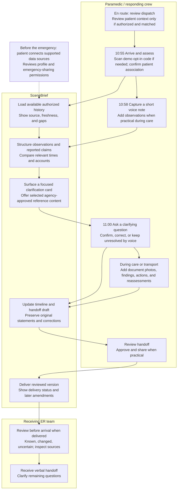

# SceneBrief — Consolidated User Journey

October 24, 2026 · Hackathon design handoff

SceneBrief helps a paramedic build a clear patient history while delivering emergency care. The responder captures short voice notes and photographs, reviews discrepancies against available patient and wearable records, and sends a source-linked, crew-reviewed handoff to the ER.

**The central interaction:** capture an account → inspect evidence worth clarifying → record a clarification → carry the correction into the handoff.

The patient portal prepares the data. The paramedic’s mobile workflow is the center of the product. The ER receives the result.

## 1. Journey map

En-route patient context requires an authorized dispatch integration and reliable patient matching. In the core hackathon flow, the crew unlocks the synthetic profile through an on-scene demo code. Patient-specific information is not assumed available before that step.

## 2. Journey at a glance

| Stage | Paramedic’s task | SceneBrief interaction | Result |
| --- | --- | --- | --- |
| En route | Understand the dispatch report and prepare | Open incident; inspect any available authorized context | Initial questions, with identity and data gaps visible |
| Arrival | Assess the patient and establish identity | Confirm patient association; scan demo opt-in code if needed | Relevant history attached to the correct incident |
| Assess and capture | Record what the crew observes and witnesses report | Push-to-talk; review extracted claims when practical | Structured notes with speaker, event time, and capture time |
| Clarify | Resolve a discrepancy that matters | Inspect source; ask witness; record correction or leave unresolved | A more accurate account without silently discarding earlier statements |
| Continue care | Apply the appropriate assessment workflow | Open responder-selected, agency-approved reference | Guidance matched to certification; undocumented items remain visible |
| Transport | Reassess and communicate changes | Add measurements, actions, responses, and document photos | Current incident timeline and handoff draft |
| Handoff | Communicate the patient’s story | Review, approve, and share | ER receives a concise record with evidence and uncertainty preserved |

No step is required before treatment or transport. The application supports short, deliberate interactions rather than continuous narration. The driver does not interact while driving.

## 3. Before the call: patient preparation

**Patient screen: My emergency profile**

The patient connects supported wearable accounts, reviews relevant medical history and emergency contacts, and configures emergency-sharing permissions. The screen shows last synchronization and when self-reported information was last reviewed.

**Actions:** Connect device · Review profile · Manage sharing

For the demo, an opt-in code identifies a fictional profile. In production, a code would identify a record but would not itself grant unrestricted access: responder authentication, authorization, patient matching, and access logging are necessary. Enrollment does not mean the patient is continuously monitored, and connecting an account does not guarantee access to every sensor feature.

## 4. The paramedic’s journey, screen by screen

### A. Open the incident and get oriented

**Screen: Incident brief**

> **Person found down near running trail**\
> Dispatch report: confused, breathing.\
> Patient profile: not yet matched.\
> Patient history: available after authorized access and identity confirmation.

**Actions:** Open incident · Scan demo code · Confirm patient association

After matching, the brief shows the available workout record and its timestamps. WHOOP overnight metrics remain under **Background**. Missing or stale data are explicit.

The crew can ask: **“Where does the workout start time come from?”** The assistant answers from the imported record and links to the source. It does not infer a diagnosis from the workout.

### B. Capture the initial account

**Screen: Capture**

A large push-to-talk control, a visible recording indicator, and an editable transcript support a brief note:

> “Twenty-four-year-old male. Confused, hot sweaty skin. Heart rate 140. Friend describes a short run and says he dropped about five minutes ago.”

| Extracted information | Source and status |
| --- | --- |
| Confusion and hot, sweaty skin | Crew observation |
| Heart rate 140 | Crew dictation; measurement time and device need attribution |
| Short run | Friend report, relayed by crew |
| Dropped about five minutes ago | Friend estimate; meaning and reference time unclear |

**Actions:** Record · Edit transcript · Add photo · Review clarification

Event time and capture time are separate. Speech extraction is reviewable; it does not automatically establish a fact as clinically confirmed.

### C. Inspect and clarify a discrepancy

**Screen: Timing needs clarification**

> **Reported account**\
> “Short run; dropped about five minutes ago.”
>
> **Available evidence**\
> Workout record begins at 09:05.\
> Device-reported fall event at 10:42 — synthetic fixture.\
> Dispatch call recorded at 10:44.\
> Crew arrival recorded at 10:55.
>
> **Suggested question**\
> “Did you see him collapse, or did you find him afterward? About what time?”

**Actions:** Record clarification · Keep unresolved · View sources

For this consolidated demo, the witness clarifies:

> “I found him around 10:43 and called at 10:44. I didn’t see him fall. Five minutes was a guess.”

The paramedic records that statement by voice. SceneBrief updates discovery time, leaves collapse time unknown, and preserves the original estimate and its correction.

**Demo centerpiece:** A single clarification changes both the timeline and the handoff. The application recognizes that a witness estimate and a device event are not equivalent measures of downtime.

### D. Review the appropriate assessment reference

**Screen: Assessment reference**

The responder selects an applicable agency-approved pathway. The screen displays its title, version, certification level, relevant reference content, documented findings, and unresolved information.

**Actions:** Open reference · Record finding · Contact medical control, where supported by agency workflow

“Not documented” does not mean “not performed.” The app does not generate treatment instructions from wearable trends or require checklist completion before transport. Prototype reference content must be clearly labeled and clinically reviewed before operational use.

### E. Add context and reassess during transport

**Screen: Reassessment**

The crew records measurements, observations, actions, and patient responses. A medication-list photograph can be added whenever practical during care or transport; it is optional, not a required stage.

Every measurement shows **collection time, device/source, value, and who recorded it**. A photographed medication list retains its image and document date; current use is not assumed.

**Actions:** Record update · Add photo · View changes · Review handoff

Historical wearable readings stay separate from current clinical measurements. Clinical-monitor readings are imported only through supported integrations; otherwise they are entered manually. Connection loss or stale readings never appear as stability.

### F. Review and share the ER handoff

**Screen: Handoff review**

> **Presentation**\
> Patient found on ground after recorded outdoor workout. Confusion and hot, sweaty skin documented by crew.
>
> **Known / reported, with sources**\
> 09:05 — workout record starts.\
> Approximately 10:43 — friend reports finding patient.\
> 10:44 — emergency call recorded.\
> 10:55 — crew arrival recorded.
>
> **Device context**\
> 10:34 — recorded pace changes; clinical significance unknown.\
> 10:42 — device-reported fall event; relationship to collapse unconfirmed.
>
> **Changed**\
> Friend clarified that they did not witness collapse. Earlier “five minutes” estimate was a guess.
>
> **Uncertain**\
> Exact symptom onset, collapse time, and duration of any loss of consciousness.
>
> **Clinical findings and care**\
> Crew-reviewed measurements, observations, actions, and responses populate here.

**Actions:** Edit · Mark reviewed · Share handoff

The receiving ER sees the reviewed version, source links, and delivery status. A subsequent correction creates a visible amendment. The record supports the verbal handoff rather than replacing it. If sharing fails, the crew can use the locally available brief and normal communication channels.

## 5. Consistent synthetic demo timeline

The scenario is a runner found down after exertion in hot conditions, with heat illness among the concerns. The app does not label the case as confirmed heat stroke from wearable evidence.

| Time | Source | Demo event | Interpretation boundary |
| --- | --- | --- | --- |
| Previous night | Synthetic WHOOP record | Recovery 18%; resting HR +9 bpm relative to baseline; skin temperature deviation +0.8 °C | Background context; not a diagnosis or core temperature |
| 09:05 | Synthetic workout record | Outdoor workout starts | Start of recorded workout, not illness onset |
| During workout | Separately sourced synthetic weather record | 88 °F, 70% humidity near the route | Environmental estimate, not body temperature or an Apple Watch sensor measurement |
| 09:05–10:34 | Synthetic wearable samples | Heart rate rises while recorded pace slows | Device observations; cause unknown |
| 10:34 | Synthetic workout record | Pace becomes variable | Does not establish neurological symptoms or gradual illness onset |
| 10:42 | Synthetic fall-event fixture | Device reports a fall | Does not establish collapse, unconsciousness, or downtime |
| Approximately 10:43 | Witness clarification | Friend finds patient on ground | Discovery time, not collapse time |
| 10:44 | Synthetic dispatch record | Friend calls emergency services | Consistent with discovery before the call |
| 10:55 | Crew record | Arrival; confusion, hot sweaty skin, HR 140 documented | Clinical observations with source and measurement attribution |
| 10:58 | Crew voice note | Initial witness estimate captured | Uncertain account awaiting clarification |
| 11:00 | Crew clarification | Witness explains discovery time and earlier guess | Timeline and handoff update together |

The 97-minute interval from workout start to device-reported fall is elapsed recorded time. It is not proof of 97 minutes of continuous exertion, illness, or heat stroke.

## 6. Evidence handling and data availability

- Pace changes can motivate a question; they cannot prove symptom onset was gradual.
- A device-reported fall does not establish how long a patient was unconscious or incapacitated.
- Absence of an irregular-rhythm alert must not be presented as evidence excluding a cardiac event.
- A recorded workout and hot weather provide context, not a distinctive diagnostic signature of heat stroke. See the [CDC clinical overview](https://www.cdc.gov/yellow-book/hcp/environmental-hazards/heat-and-cold-illness-in-travelers.html).
- WHOOP’s public API does not expose continuous historical heart rate. Second-by-second agreement between WHOOP and Apple must remain explicitly synthetic unless another supported source is available. See [WHOOP developer documentation](https://developer.whoop.com/docs/developing/support/).
- Verify access to each Apple data type, including fall events, before promising integration. Do not assume every device feature is available to third-party apps.
- Agreement between consumer sensors does not establish a diagnosis or make either source ground truth. Show disagreement and gaps rather than forcing reconciliation.
- The core flow must work with one connected source, stale data, or no wearable history.

## 7. Hackathon scope and demonstration

**Build first:** a fictional patient profile, demo-code association, responder mobile interface, voice/text capture, source-linked timeline, clarification loop, protocol-reference placeholder, and reviewed ER handoff.

**Demonstration sequence:**

1. Briefly show the enrolled fictional patient profile.
2. Switch to the paramedic: open the incident and match the profile.
3. Record the initial account through voice or scripted demo input.
4. Open the timing clarification card and inspect its sources.
5. Record the witness’s clarification.
6. Show discovery time updating while collapse time stays unknown.
7. Add a reassessment and review the handoff.
8. Share it and show the receiving ER view.

**The main design test:** Does the paramedic preserve a more accurate account with less searching and manageable interaction time? Measure information retrieval, misattributed facts, handoff omissions, and added interaction time. Improved survival remains a long-term outcome to investigate, not a demonstrated hackathon result.

## Source documents

- [Original user-journey diagram and workflow](SceneBrief-User-Journey.md.txt)
- [Detailed emergency-care journey](user-journey.md)
- [Original hackathon concept and demo case](SceneBrief-Hackathon-Handoff.md.txt)

This consolidated version keeps the originals intact, expands the paramedic workflow, and reconciles the demo’s discovery and dispatch times.
